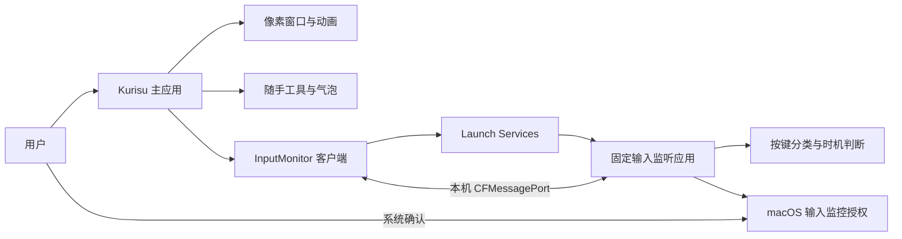
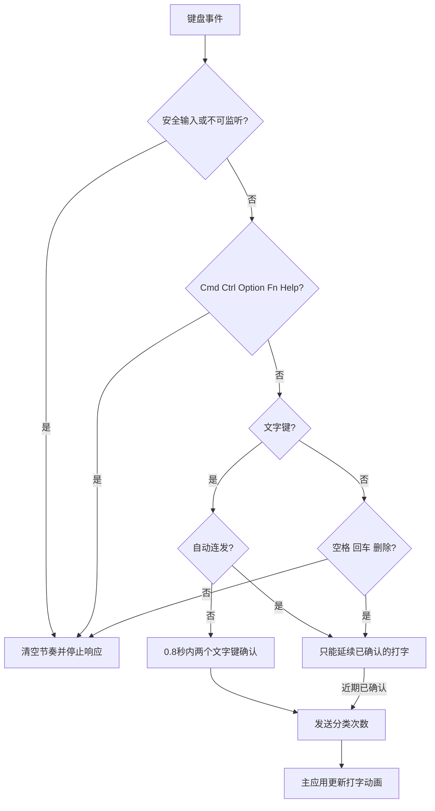

# 架构与运行流程

对应本地 0.9.0 / build 17，文档基线 2026-11-08。
本页描述源码设计；运行验收范围见 [验收台账](ACCEPTANCE.md)。

## 进程结构

| 模块 | 主要文件 | 职责 |
|---|---|---|
| 主应用入口 | Sources/main.swift | 单实例检查、菜单栏、设置窗口、退出 |
| 行为调度 | Sources/AppModel.swift | 24 Hz 渲染时钟、行为优先级、位置/尺寸、生命周期 |
| 像素视图 | Sources/PetView.swift、SpriteAtlas.swift | 图集读取、最近邻绘制、拖动与透明区域点击 |
| 动画状态 | Sources/LaptopAnimation.swift、RestAnimation.swift | 打字进出与反转、坐姿保持与小幅活动 |
| 实用功能 | Sources/UtilityStore.swift、UtilityView.swift | 便签、暂存、历史、唤醒、休息计时与台词 |
| 辅助窗口 | Sources/UtilityWindows.swift、HoverSummaryView.swift | 工具、情境气泡、悬浮信息卡、焦点和位置 |
| 输入客户端 | Sources/InputMonitor.swift | 安装/启动/连接组件、接收活动结果与更新状态 |
| 固定安装 | Sources/InputAgentInstallation.swift | 签名/哈希检查、相同版本复用、暂存替换与失败恢复 |
| 监听进程 | InputAgent/main.swift、KeyboardEventMonitor.swift | 权限申请、被动监听、会话/心跳管理 |
| 打字判断 | InputAgent/TypingActivityFilter.swift | 修饰键、按键类别、连发与时机判断 |
| IPC 协议 | Shared/InputAgentProtocol.swift | 请求/回应结构与版本（当前为 1） |

## 启动与授权流程

1. 主应用初始化设置、图集、窗口和工具数据，开启渲染时钟。
2. 输入客户端准备 `Application Support/KurisuDesktop/InputAgent/` 下的独立应用。
3. 指纹、签名及可执行文件匹配时复用固定副本；需要更新时先准备暂存副本再替换。
4. 通过 Launch Services 启动组件，传入随机端口名、会话令牌和主进程 PID。
5. 客户端后台请求状态；组件只在允许且会话/屏幕可用时安装事件 tap。
6. 用户点击“我授权”后，组件调用系统授权接口；系统设置中的最终确认由用户完成。
7. 主应用通过状态请求识别授权结果；必要时重启组件刷新状态。
8. 只有组件实际监听、响应未过期、无安全输入且会话可用时才接受打字结果。

“组件进程存在”“权限已允许”“监听已建立”和“收到确认的文字按键”是不同状态。
设置页和记录不得将它们混写成同一件事。

## 打字事件处理

Shift、Caps Lock 保留。快捷键涉及的字母在释放前被抑制，即使先松修饰键也不能
通过剩余连发重新启动。鼠标点击、滚动和监听中断清除节奏。
聚合计数只表示一般活动，不作为打字兜底。不读取 Unicode 或输入框内容，
所以不保证确认文字已经插入前台应用。

### IPC 与时序参数

| 项目 | 当前源码值 / 行为 |
|---|---|
| 主渲染时钟 | 24 Hz；异步串行请求，最多一个请求在途 |
| 单次发送 / 接收超时 | 0.10 / 0.15 秒；后台队列 |
| 监听状态新鲜度 | 最近响应距离现在小于 2 秒 |
| 组件定时器 | 0.1 秒，监听状态常规刷新约每秒 |
| 主应用无响应 | 心跳间隔超过 3 秒，组件停止监听；超过 30 秒退出 |
| 主进程消失 | 组件检查进程后退出 |
| 授权中通信宽限 | 客户端对短暂无回应给予最多 120 秒宽限 |
| 返回系统设置的恢复 | 授权开始后 300 秒内，最多 3 次，至少间隔 2 秒 |
| 回应数据 | 权限、监听、安全输入、会话、活动标记、打字次数、打断及鼠标类别 |

这些是代码设定，不是本次实测延迟。令牌匹配和签名检查是本机组件的基本防误连措施，
不作为抵御同一用户权限下所有恶意进程的完整安全保证。

## 动画运行流程

行为选择顺序为：暂停 → 拖动 → 电脑动作 → 强制动作 → 长待机休息 → 普通待机。
显式点击会清除旧打字节奏并播放开心；新的有效文字输入可再次优先触发电脑动作。

| 动作 | 运行规则 |
|---|---|
| 电脑进入 | 约 0.75 秒，12 帧 |
| 持续打字 | 16 帧，每帧 0.10 秒；高频输入时播放时钟乘 1.55 |
| 暂停等待 | 最后一次确认打字后约 1.1 秒停止敲键；12 帧，每帧 0.30 秒 |
| 收起电脑 | 最后一次确认后约 3.2 秒开始退出，约 0.80 秒，12 帧 |
| 退出中重新输入 | 反转进度，沿相同位置返回 |
| 长待机 | 无观察活动超过 90 秒开始坐下 |
| 坐姿休息 | 帧 0–4 各 0.28 秒一次，然后帧 5；偶尔帧 6 点头 |
| 休息小动作 | 呼吸周期 4.8 秒、偏移 1 素材像素；点头周期 11 秒 |
| 减少动画 | 根据用户/系统设置使用静态状态反馈 |

打字图集 3072 × 832（16 列 × 4 行），单元 192 × 208；当前内容 163 × 176。
休息图集 1536 × 208，开心图集 960 × 208。图集与透明点击映射共用相同帧。

## 数据与存储边界

| 数据 | 存放 | 生命周期 |
|---|---|---|
| 大小、位置、开关等偏好 | UserDefaults | 跨启动保存 |
| 便签、暂存元数据、当日估算 | Application Support/KurisuDesktop/utilities.json | 本地持久化 |
| 文件暂存副本 | 同目录 Shelf/ | 手动移除前保留；不是原文件 |
| 剪贴板历史 | 主应用内存 | 最多 40 条；退出清空，图片合计不超过 32 MB |
| 当前按住/抑制键与判断时间 | 输入组件内存 | 按键释放、打断或组件退出时清除 |
| 输入会话令牌与分类结果 | 两进程内存 | 会话结束失效，不进入源码、日志或导出包 |
| 组件副本 | Application Support/KurisuDesktop/InputAgent/ | 普通桌宠更新复用 |
| 源素材、正式图集 | assets/source/、KurisuDesktop/Resources/ | 随仓库维护 |
| 本地产物与临时文件 | outputs/、work/ | Git 忽略，按需整理 |

## 构建与更新流程

`scripts/build.sh` 编译主应用，成功后关闭本项目旧应用，调用独立组件构建脚本，
复制资源并签名主应用。`build_input_agent.sh` 的指纹只包含 InputAgent 源码、
组件 Info.plist、Shared 协议与自身构建指令，不包含主应用版本和素材。

复用条件依赖已有内嵌组件仍在且校验通过；因此清理文件时保留
`outputs/Kurisu.app/Contents/Helpers/`。彻底删除导出应用再重建不保证旧二进制身份相同。

组件协议或输入过滤逻辑变更属于组件更新，应单独说明可能重新授权；
普通气泡、工具和图像改动应只更新主应用。详细限制见 [INPUT_AGENT](INPUT_AGENT.md)。
